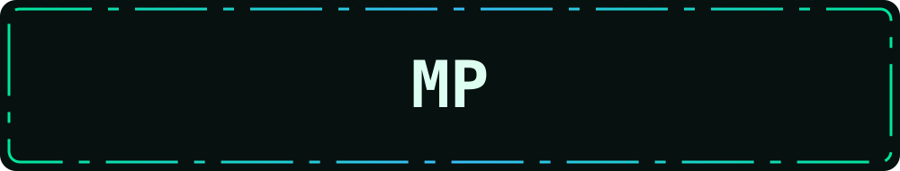

### Olá! 👋

Estudo **Ciência da Computação** e faço pós-graduação em **Ciência de Dados** e **Arquitetura e Projetos Cloud**.

Sou curioso por tecnologia e gosto de aprender na prática. Por aqui tem um pouco de tudo: exercícios, ideias e experimentos. Agora estou organizando esse caminho para construir um portfólio mais consistente, em um único lugar.

### Tecnologias sendo exploradas

**Linguagens**

**Web e mobile**

**Backend e dados**

**Cloud e infraestrutura**

**IDEs e ferramentas**

**Redes**

TCP/IP · DNS · Roteamento · HTTP

> Já tive contato com as tecnologias mencionadas, mas continuo aprendendo e não domino todas elas.

**Um commit de cada vez.**

